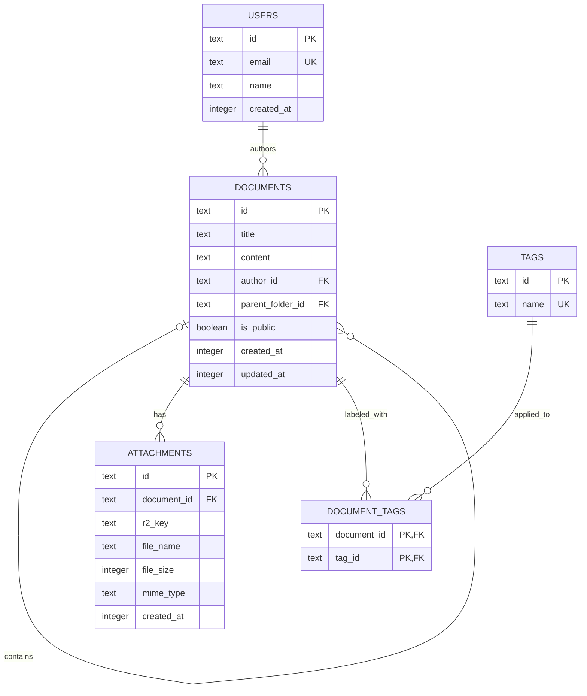

# Database Schema

The schema is defined in `src/db/schema.ts` using Drizzle's SQLite core for Cloudflare D1. TypeScript properties use camelCase while SQLite column names use snake_case. IDs are UUID strings generated by Drizzle when inserting records. Timestamp columns are stored as Unix milliseconds and default to the current time; application updates to a document should also set `updatedAt`.

## ERD



## Relations

- A user authors zero or more documents. Deleting a user cascades to their documents.
- A document may reference a parent document through `parentFolderId`; deleting the parent sets child references to `NULL`. Documents serve as the hierarchy's parent/folder records because there is no separate folders table.
- Documents and tags have a many-to-many relationship through `document_tags`. Its composite primary key prevents duplicate assignments; deleting either endpoint removes the join row.
- A document has zero or more attachments. Deleting a document cascades to its attachments; `r2Key` stores the corresponding object key in R2.
- User email and tag name are unique. `isPublic` is a SQLite integer boolean and defaults to `false`.

## Local Migrations

Install Drizzle Kit, Drizzle ORM, and Wrangler if they are not already project dependencies. Generate SQL migrations from the schema, then apply them to the local D1 database:

```sh
npx drizzle-kit generate --name=initial
npx wrangler d1 migrations apply DB --local
```

`drizzle.config.ts` writes SQL into `drizzle/`, and the D1 binding in `wrangler.toml` sets that directory as its `migrations_dir`. To check that the local tables were created:

```sh
npx wrangler d1 execute DB --local --command "SELECT name FROM sqlite_master WHERE type = 'table' ORDER BY name;"
```

## Local Seeding

Create a SQL seed file at `drizzle/seed.sql`, with inserts matching the schema, then execute it against local D1. For example:

```sql
INSERT INTO users (id, email, name)
VALUES ('seed-user-1', 'writer@example.com', 'Example Writer');

INSERT INTO documents (id, title, content, author_id)
VALUES ('seed-document-1', 'Welcome', '# Welcome', 'seed-user-1');

INSERT INTO tags (id, name)
VALUES ('seed-tag-1', 'getting-started');

INSERT INTO document_tags (document_id, tag_id)
VALUES ('seed-document-1', 'seed-tag-1');
```

Timestamp columns omitted from these inserts use their schema defaults. Run the seed file with Wrangler:

```sh
npx wrangler d1 execute DB --local --file=./drizzle/seed.sql
```

The seed uses fixed IDs so it is repeatable only after clearing or recreating the local database. Keep test seed data out of production; omit `--local` only when you intentionally mean to target the remote database.